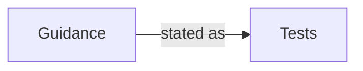

<!--
GENERATED FILE. DO NOT EDIT DIRECTLY.

The authoritative source is in content/. Regenerate this reading copy with:
    python process/tools/build_core_markdown.py --assembly Example.qmd
-->

# Example Core Document

*Test fixture for the shared tools*

> This is a generated reading copy for GitHub. For review and editing, use the
> [canonical section files](content/README.md).

---

# Summary

This fixture exercises the shared build and check tools. See the
[detail section](content/01-detail.md).

This second paragraph verifies positions within one anchor area.

This third paragraph supports legacy comment placement checks.

- The fixture also includes a commentable list.
- Its position follows the paragraphs in the same area.

The anchor syntax can be shown literally in fenced code:

```markdown
<!-- anchor: fixture-introduction -->
```

---

# Detail

A second section, with an open item for review.



*Figure 1. A fixture diagram, drawn in the guide and the Word document.*
<!-- CONFIRM: Fixture CONFIRM note reported by check_content.py. -->

| ID | Item | Status |
|---|---|---|
| FX-1 | A row that is a review area of its own | Open |
| FX-2 | A second row, named from its first cell | Open |

Text after the table belongs to the review item area again.
