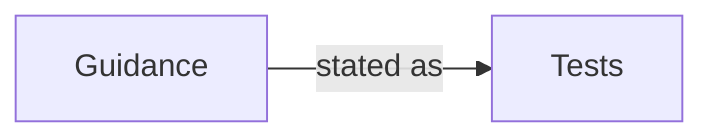

<!--
GENERATED FILE. DO NOT EDIT DIRECTLY.

The authoritative source is in content/. Regenerate this reading copy with:
    python process/tools/build_core_markdown.py --assembly Example.qmd
-->

# Example Core Document

*Test fixture for the shared tools*

> This is a generated reading copy for GitHub. For review and editing, use the
> [canonical section files](content/README.md).

---

# Executive Summary

> **Status:** Test fixture for the shared tools. Nothing here is guidance.

This fixture exercises the shared build and check tools. See the
[detail section](content/01-detail.md).

> **Changed in v0.2.0:** Says how positions are counted within an area.

This second paragraph verifies positions within one anchor area.

This third paragraph supports legacy comment placement checks.

- The fixture also includes a commentable list.
- Its position follows the paragraphs in the same area.

The anchor syntax can be shown literally in fenced code:

```markdown
<!-- anchor: fixture-introduction -->
```

This summary is long enough to pass the length check without a warning. It
stands in for the one-page overview a Topic Reference gives a reader who reads
nothing else: what the topic is, why it matters, what the document decides,
and what is still open. The build places it first, above the chapters, with
the status banner above it, the list of what changed in this version after
it, then the primary infographic when there is one, and then the scope. None
of these parts has an entry in the section bar, and none counts as a chapter.
Comments, review flags, and change markers work here as they do anywhere else.

---

# What changed in v0.2.0

- [Detail](#detail): New review process. Tell us whether these steps match your program's practice. *(feedback wanted)*
- [Detail](#detail): New row. Is a second review area needed here? *(feedback wanted)*
- [Executive Summary](#executive-summary): Says how positions are counted within an area.
- [Detail](#detail): The detail section gained a review table with row anchors.
- [Detail](#detail): Status wording updated after the October call.

---

# Scope

This fixture checks the shared build and check tools against a small document.

## In scope

- Building the web guide, the reading copy, and the Word document.
- Review anchors, row anchors, and change markers.

## Out of scope

- Publishing a guide, described in the [process guidance](../../guidance/Process.md).
- Slide decks (not covered by any current topic).

## Not yet decided

- Whether the fixture should include an appendix.

---

> **Changed in v0.2.0:** The detail section gained a review table with row anchors.

# Detail

> **Changed in v0.2.0, feedback wanted:** New review process. Tell us whether these steps match your program's practice.

A second section, with an open item for review.



*Figure 1. A fixture diagram, drawn in the guide and the Word document.*
<!-- CONFIRM: Fixture CONFIRM note reported by check_content.py. -->

> **Changed in v0.2.0 (FX-1):** Status wording updated after the October call.

> **Changed in v0.2.0 (FX-2), feedback wanted:** New row. Is a second review area needed here?

| ID | Item | Status |
|---|---|---|
| FX-1 | A row that is a review area of its own | Open |
| FX-2 | A second row, named from its first cell | Open |

Text after the table belongs to the review item area again.
